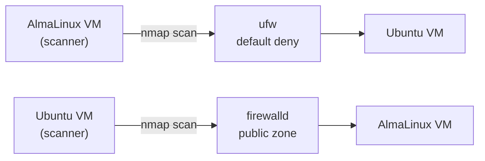
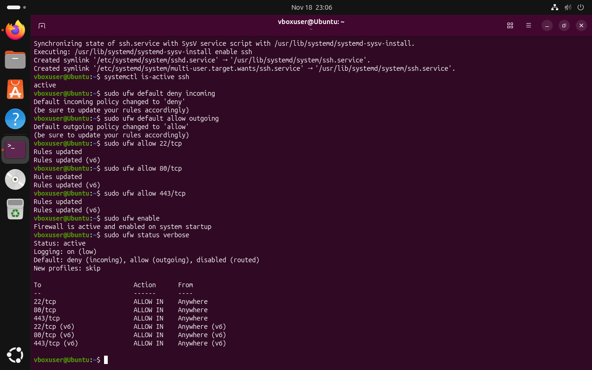
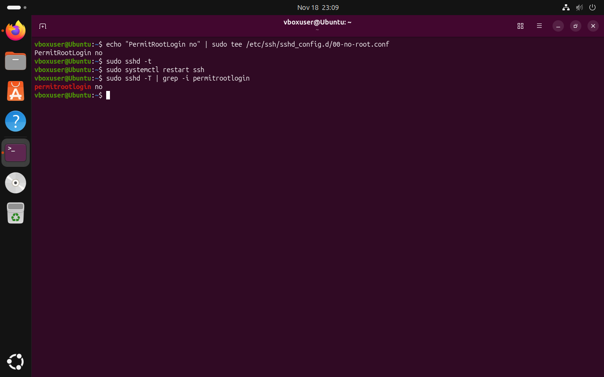

# Firewall and SSH Hardening

**Phase:** 2 (Cloud Bootcamp) | **Tools:** ufw, firewalld, OpenSSH, nmap, netcat, VirtualBox NAT Network

## Business Scenario
A public-facing web server should expose only what it needs: SSH for administration, and HTTP/HTTPS for visitors. Everything else should be blocked, and nobody should be able to log in directly as root. This project locks down two servers and then **proves** the lockdown works from a second machine, the way an attacker would see it.

## Security Goals

| Port | Service | Status |
|---|---|---|
| 22 | SSH | ✅ Allowed |
| 80 | HTTP | ✅ Allowed |
| 443 | HTTPS | ✅ Allowed |
| Everything else | | ❌ Blocked |
| Root login over SSH | | ❌ Disabled |

## Architecture



Both VMs sit on a shared VirtualBox NAT Network so each one can scan the other.

## What I Built

**Ubuntu (ufw)**
```bash
sudo ufw default deny incoming
sudo ufw default allow outgoing
sudo ufw allow 22/tcp
sudo ufw allow 80/tcp
sudo ufw allow 443/tcp
sudo ufw enable
```

**AlmaLinux (firewalld)**
```bash
sudo firewall-cmd --permanent --remove-service=cockpit
sudo firewall-cmd --permanent --remove-service=dhcpv6-client
sudo firewall-cmd --permanent --add-service={ssh,http,https}
sudo firewall-cmd --reload
```

**Disable root SSH login (both servers)**
```bash
echo "PermitRootLogin no" | sudo tee /etc/ssh/sshd_config.d/00-no-root.conf
sudo sshd -t                                   # validate config before restarting
sudo systemctl restart ssh                     # sshd on AlmaLinux
sudo sshd -T | grep -i permitrootlogin         # confirms: permitrootlogin no
```
The `00-` prefix makes this file load first, so it takes priority over other SSH settings.

## Verification

**Why a second machine:** traffic a server sends to itself skips the firewall, so scanning from localhost makes every port look open. A real test has to come from outside.

On the server under test, I started a listener on a port that should be blocked:
```bash
nc -lk 8080
```
From the other VM:
```bash
nmap -p 22,80,443,3306,8080 TARGET_IP
ssh root@TARGET_IP
```

| Port | nmap result | Meaning |
|---|---|---|
| 22 | `open` | Allowed, SSH listening |
| 80 | `open` | Allowed, web server listening |
| 443 | `closed` | Allowed by the firewall, but no HTTPS service yet |
| 3306 | `filtered` | Blocked by the firewall |
| 8080 | `filtered` | Blocked, **even though a service is listening**. This proves the firewall is doing the work |

`ssh root@TARGET_IP` returned **Permission denied** even with the correct root password.

## Screenshots

Screenshots are from the Ubuntu build.

### ufw rules: default deny, only 22, 80, and 443 allowed


### Root SSH login disabled


## ufw vs firewalld

| | ufw (Ubuntu) | firewalld (AlmaLinux) |
|---|---|---|
| Open a port | `ufw allow 80/tcp` | `firewall-cmd --permanent --add-service=http` |
| Apply changes | Immediate | `firewall-cmd --reload` |
| Check rules | `ufw status verbose` | `firewall-cmd --list-all` |
| Model | Rules | Zones (default zone `public`) |

## What I Learned
- **Default deny** is the safest starting point: open only what you need
- The difference between `open`, `closed`, and `filtered` in a port scan
- Why security has to be tested from outside the system
- Validate config (`sshd -t`) before restarting a service so you don't lock yourself out

## Business Value
Most breaches start with an exposed service or weak remote access. This is the same thinking behind AWS **security groups** and **network ACLs**, and it's the kind of evidence (before and after scans) that security audits and compliance reviews ask for.

## Next Iteration
- Switch SSH to key-only authentication and disable passwords
- Add fail2ban to block repeated login attempts
- Recreate the rules as AWS security groups on EC2
