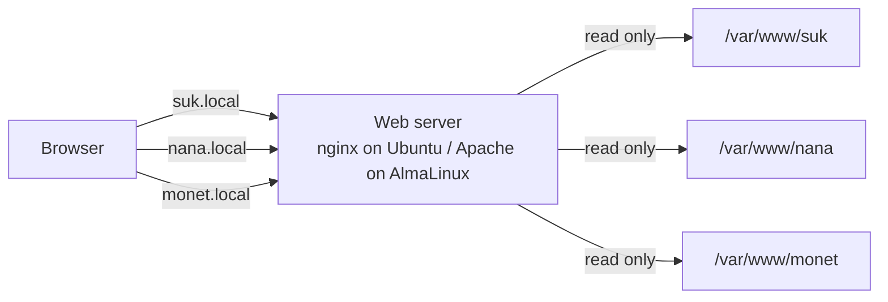
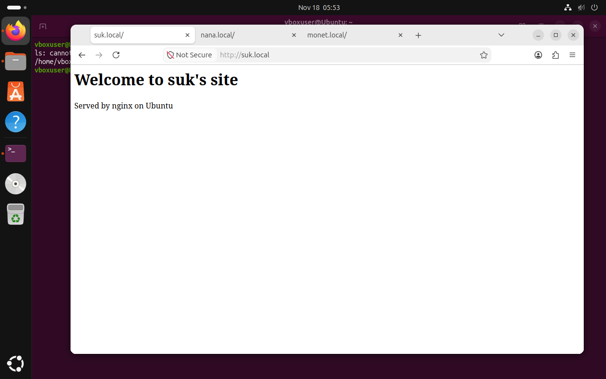
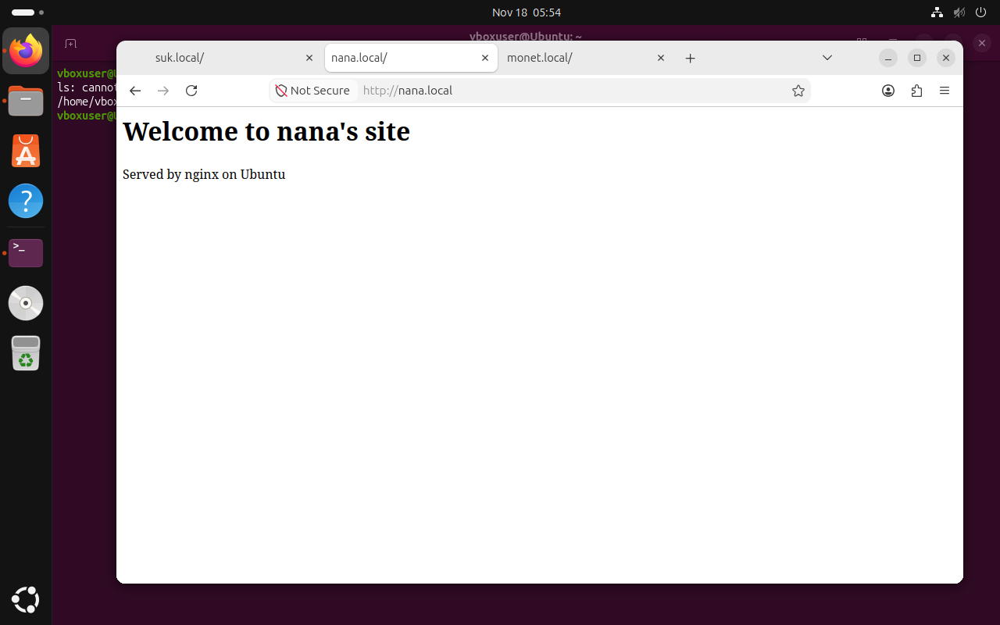
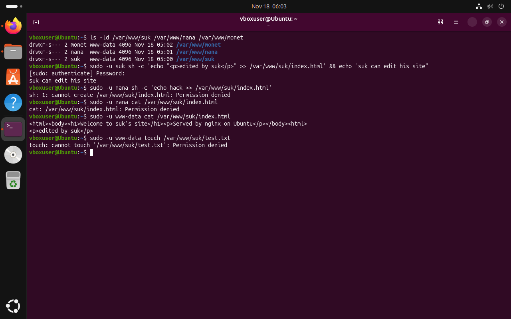

# Multi-User Web Server on Ubuntu and AlmaLinux

**Phase:** 2 (Cloud Bootcamp) | **Tools:** nginx, Apache (httpd), Ubuntu, AlmaLinux, SELinux, Linux permissions

## Business Scenario
A shared web server hosts sites for three users: suk, nana, and monet. Each person must be able to edit their own site and nobody else's, and the web server must be able to read every site without being able to change any of them. I built the same setup on both major Linux families: Debian-based (Ubuntu) and Red Hat-based (AlmaLinux).

## Architecture



## Permission Design

| Path | Owner : Group | Mode | Effect |
|---|---|---|---|
| `/var/www/<user>` | `<user>` : web server group | `2750` | Owner has full control. Web server can read and enter. Other users get nothing. The setgid bit (`2`) makes new files inherit the web server group |
| `/var/www/<user>/index.html` | `<user>` : web server group | `640` | Owner can edit. Web server can read. Nobody else |

The web server group is `www-data` on Ubuntu and `apache` on AlmaLinux.

## What I Built
1. Installed and enabled the web server (`apt install nginx` / `dnf install httpd`) and opened HTTP in firewalld on AlmaLinux
2. Created three users with `useradd -m`
3. Created a site directory per user and applied the ownership and permissions above
4. Created each `index.html` **as that user** with `sudo -u`, so ownership is correct from the start
5. Configured one nginx server block (Ubuntu) or Apache virtual host (AlmaLinux) per user
6. Relabeled files for SELinux on AlmaLinux with `restorecon`
7. Mapped `suk.local`, `nana.local`, and `monet.local` in `/etc/hosts`

## Key Configuration

**nginx server block (Ubuntu)**
```nginx
server {
    listen 80;
    server_name suk.local;
    root /var/www/suk;
    index index.html;
}
```

**Apache virtual host (AlmaLinux)**
```apache
<VirtualHost *:80>
    ServerName suk.local
    DocumentRoot /var/www/suk
</VirtualHost>
```

**Permissions**
```bash
sudo chown suk:www-data /var/www/suk      # apache instead of www-data on AlmaLinux
sudo chmod 2750 /var/www/suk
sudo chmod 640 /var/www/suk/index.html
```

## Verification

```bash
curl http://suk.local                                         # site loads
sudo -u suk  sh -c 'echo "<p>edit</p>" >> /var/www/suk/index.html'   # succeeds
sudo -u nana sh -c 'echo hack >> /var/www/suk/index.html'           # Permission denied
sudo -u nana cat /var/www/suk/index.html                            # Permission denied
sudo -u www-data cat /var/www/suk/index.html                        # succeeds (read)
sudo -u www-data touch /var/www/suk/test.txt                        # Permission denied (no write)
```

| Test | Result |
|---|---|
| Owner edits own site | ✅ Allowed |
| Another user reads or edits it | ❌ Denied |
| Web server reads it | ✅ Allowed |
| Web server writes to it | ❌ Denied |

## Screenshots

Screenshots are from the Ubuntu + nginx build.

### Each user's site served by nginx
| suk.local | nana.local | monet.local |
|---|---|---|
|  |  |  |

### Permission tests
Owner can edit, another user is denied, and the web server can read but not write.



## Challenges and Fixes

| Problem | Cause | Fix |
|---|---|---|
| 403 Forbidden on nginx | Wrong group or mode on the site folder | Set group to `www-data` and mode `2750`, check with `ls -ld` |
| 403 Forbidden on Apache even with correct permissions | SELinux label on the files | `sudo restorecon -Rv /var/www`, confirm with `ls -Z` |
| Default welcome page instead of the user's site | Hostname missing from `/etc/hosts`, or browsing by IP | Add the `.local` names and browse by name |

## What I Learned
- Linux permission bits, groups, and the **setgid** bit for shared directories
- Debian vs Red Hat differences: `apt` vs `dnf`, `www-data` vs `apache`, `sites-available` vs `conf.d`
- **SELinux** is a second security layer on Red Hat systems. Correct permissions alone aren't always enough
- Always test access as each user, not as root

## Business Value
This is least privilege applied at the operating system level, the same idea as IAM in AWS. Shared hosting, multi-team servers, and EC2 instances running Linux all depend on getting these permissions right.

## Next Iteration
- Add HTTPS with Let's Encrypt
- Rebuild on EC2 and automate the setup with a script or Ansible
