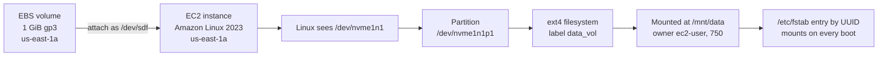

# Adding Persistent Storage with Amazon EBS

**Phase:** 2 (Cloud Bootcamp) | **Tools:** EC2, EBS (gp3), lsblk, parted, mkfs.ext4, blkid, mount, /etc/fstab | **OS:** Amazon Linux 2023

## Business Scenario
An application is running out of space, or its data needs to live separately from the operating system so it survives if the server is replaced. This project adds a new EBS volume to a running EC2 instance, prepares it for use, secures it, and makes it mount automatically after every reboot.

## Architecture



## What I Built
- Created a 1 GiB gp3 EBS volume in the same Availability Zone as my instance (us-east-1a) and attached it as `/dev/sdf`
- Identified the new disk inside Linux with `lsblk` (it appears as `/dev/nvme1n1` on Nitro instances)
- Created a GPT partition table and one partition using the whole disk
- Formatted the partition with ext4 and labeled it `data_vol`
- Mounted it at `/mnt/data` and gave ownership to `ec2-user` with `750` permissions
- Added an `/etc/fstab` entry by UUID with `nofail` so it mounts automatically and never blocks boot

## Key Commands

```bash
# Find the new 1G disk
lsblk

# Partition
DEV=/dev/nvme1n1
sudo parted -s $DEV mklabel gpt
sudo parted -s $DEV mkpart primary 0% 100%

# Format (NVMe partitions end in p1, not 1)
PART=/dev/nvme1n1p1
sudo mkfs.ext4 -L data_vol $PART
sudo blkid $PART

# Mount and secure
sudo mkdir -p /mnt/data
sudo mount $PART /mnt/data
sudo chown ec2-user:ec2-user /mnt/data
sudo chmod 750 /mnt/data

# Make it persistent (back up fstab first)
sudo cp /etc/fstab /etc/fstab.bak
echo "UUID=<partition-uuid> /mnt/data ext4 defaults,nofail 0 2" | sudo tee -a /etc/fstab

# Test fstab safely before any reboot
sudo umount /mnt/data
sudo mount -a
df -h /mnt/data
```

| Choice | Why |
|---|---|
| Same Availability Zone | An EBS volume can only attach to an instance in its own AZ |
| GPT partition | Standard partition table that tools expect, even with one partition |
| Mount by UUID, not `/dev/nvme1n1p1` | Device names can change between boots, the UUID never does |
| `nofail` | If the volume is ever missing, the server still boots |
| `chmod 750` | Owner can read and write, group can read, everyone else has no access (least privilege) |
| `mount -a` before reboot | Tests the fstab entry without risking a failed boot |

## Verification

| Test | How | Result |
|---|---|---|
| Volume attached | `lsblk` after attaching | New `nvme1n1` disk at 1G |
| Partition created | `lsblk` after `parted` | `nvme1n1p1` under `nvme1n1` |
| Filesystem created | `sudo blkid /dev/nvme1n1p1` | `TYPE="ext4"`, `LABEL="data_vol"`, UUID shown |
| fstab entry is valid | `cat /etc/fstab`, then `umount` and `mount -a` | No errors, single correct entry |
| Volume mounted | `df -h /mnt/data` | `/dev/nvme1n1p1` 988M mounted on `/mnt/data` |

## Challenges and How I Solved Them

| Problem | Cause | Fix |
|---|---|---|
| My instance did not appear in the Attach volume list | The volume and instance were in different Availability Zones | Created the volume in the instance's AZ |
| The lab's `PART=${DEV}1` pointed to a device that does not exist | On NVMe disks the partition is `nvme1n1p1`, so `${DEV}1` becomes `nvme1n11` | Set `PART=/dev/nvme1n1p1` directly |
| `mount -a` failed with "bad option" | A typo while adding the fstab entry saved an invalid mount option | Restored `/etc/fstab.bak`, re-added the entry, and re-tested before rebooting |

The last one is why the backup and the `mount -a` test matter: the mistake was caught and fixed safely instead of showing up on the next reboot.

## What I Learned
- EBS volumes are independent from instances, so data survives if an instance is replaced
- The AWS device name (`/dev/sdf`) and the Linux device name (`/dev/nvme1n1`) can differ, so always confirm with `lsblk` before formatting
- The order to make raw storage usable: attach, partition, format, mount, persist
- Linux attaches disks to folders (mount points) instead of drive letters
- `/etc/fstab` controls what mounts at boot, and one bad line can cause problems, so back it up and test it

## Business Value
Separating application data from the operating system disk is standard practice: the OS can be rebuilt without touching data, storage can grow independently, and volumes can be snapshotted for backups. As a project manager, this explains why storage changes need AZ planning, a change window, and a tested rollback step like the fstab backup.

## Next Iteration
- Take an EBS snapshot and restore it to a new volume
- Grow the volume online and extend the filesystem with `growpart` and `resize2fs`
- Format a second volume with XFS and compare
- Automate the whole setup with a user data script or Terraform
