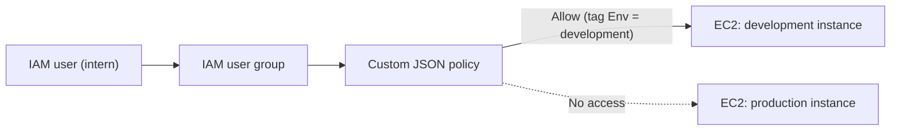
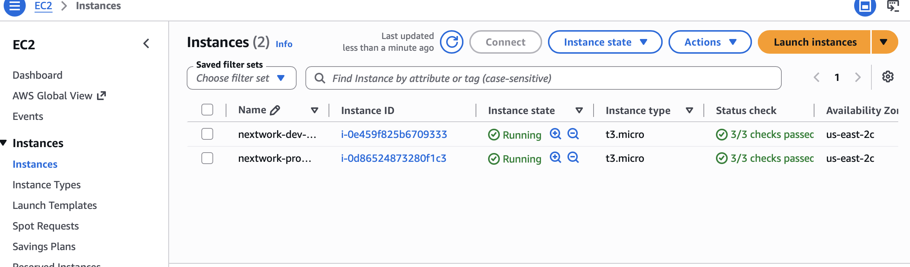
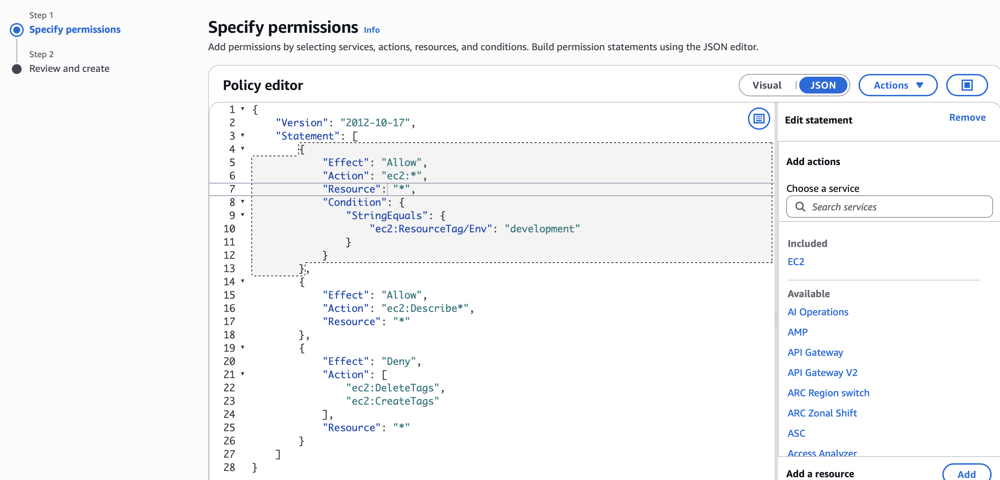
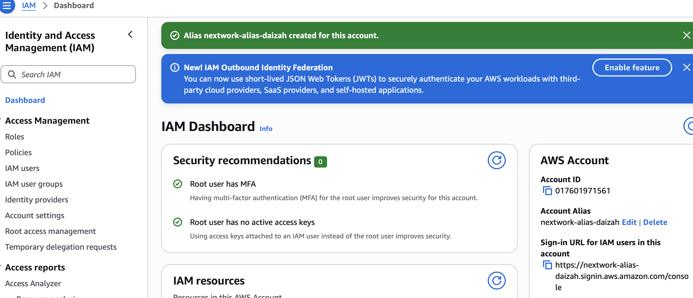
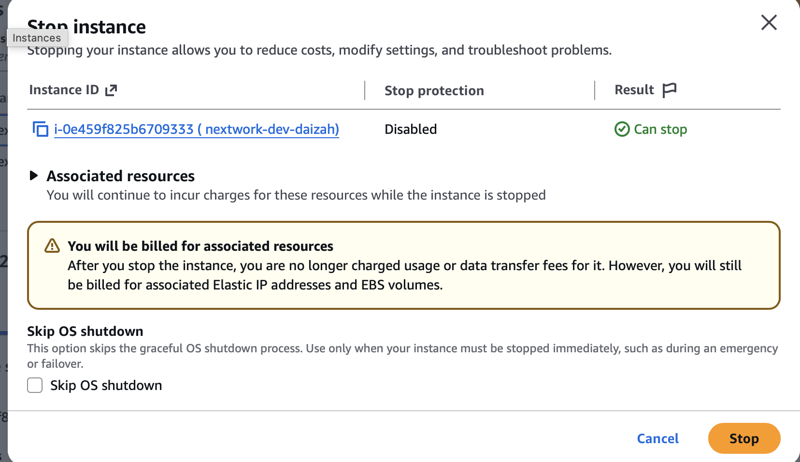

# Cloud Security with AWS IAM

**Phase:** 1 (AWS Foundations) | **Services:** AWS IAM, Amazon EC2 | **Source:** Nextwork AWS Cloud Beginner series

## Business Scenario
A new intern is joining the team. They need to work on the **development** server, but they must not be able to touch **production**. This project uses IAM to give them exactly that access and nothing more (the principle of least privilege).

## Architecture



## What I Built
- Launched two EC2 instances, one for **development** and one for **production**
- Tagged each instance with an `Env` tag so access could be controlled by environment
- Wrote a custom IAM policy in JSON (below)
- Created an IAM user group, attached the policy, and added a new IAM user to the group
- Set an **account alias** so the user gets a friendly sign-in URL
- Signed in as the new user and tested what they could and couldn't do

## The Policy

```json
{
  "Version": "2012-10-17",
  "Statement": [
    {
      "Effect": "Allow",
      "Action": "ec2:*",
      "Resource": "*",
      "Condition": {
        "StringEquals": { "ec2:ResourceTag/Env": "development" }
      }
    },
    {
      "Effect": "Allow",
      "Action": "ec2:Describe*",
      "Resource": "*"
    },
    {
      "Effect": "Deny",
      "Action": ["ec2:DeleteTags", "ec2:CreateTags"],
      "Resource": "*"
    }
  ]
}
```

| Statement | What it does | Why it matters |
|---|---|---|
| 1. Allow `ec2:*` with a tag condition | Full EC2 control, but only on instances tagged `Env = development` | Access follows the tag, so new dev servers are covered automatically |
| 2. Allow `ec2:Describe*` | Lets the user see the list of instances in the console | Without it the console can't load the instance list |
| 3. Deny tag changes | Blocks creating or deleting tags | Closes a loophole: otherwise the user could retag production as `development` and gain access. An explicit Deny always wins |

## Verification
Signed in as the intern user and tried to stop each instance:
- **Development instance** (`nextwork-dev-daizah`): the console returned **Can stop**, confirming access (screenshot below)
- **Production instance:** outside the policy's tag condition, so the same action is denied with an authorization error

## Screenshots

### EC2 instances (development and production)


### IAM policy in the JSON editor


### IAM account alias


### Testing access by stopping the development instance


## What I Learned
- How IAM evaluates permissions: everything is denied by default, Allow statements open access, and an **explicit Deny overrides any Allow**
- **Conditions** and **resource tags** make policies flexible without listing every resource
- Permissions should go on **groups**, not individual users, so onboarding and offboarding are simple
- Always test access as the actual user, not as an admin

## Business Value
Access control is one of the biggest risks in any cloud environment. Tag-based policies let a company onboard contractors or interns safely, keep production protected, and pass security audits, while making access easy to grant and remove.

## Next Iteration
- Require **MFA** for the IAM user
- Use **IAM Identity Center** for single sign-on instead of individual IAM users
- Add a **permissions boundary** to cap what any intern-level role can ever do

## Resources
- [Nextwork project guide](https://learn.nextwork.org/projects/aws-security-iam)
- [AWS IAM documentation](https://docs.aws.amazon.com/iam/)
