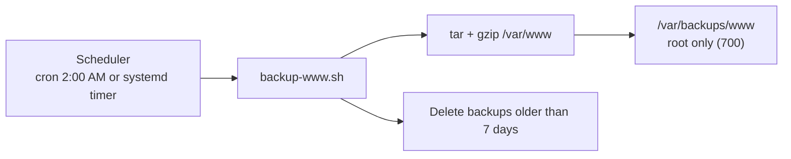
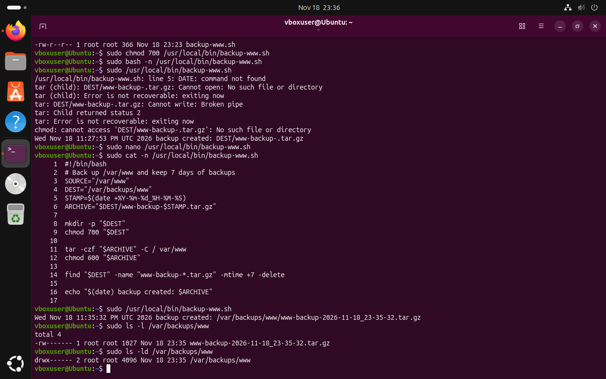
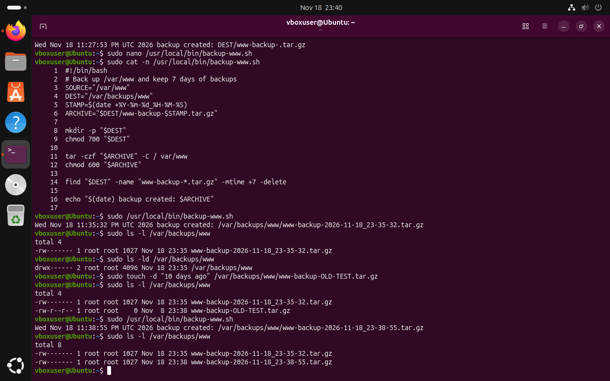
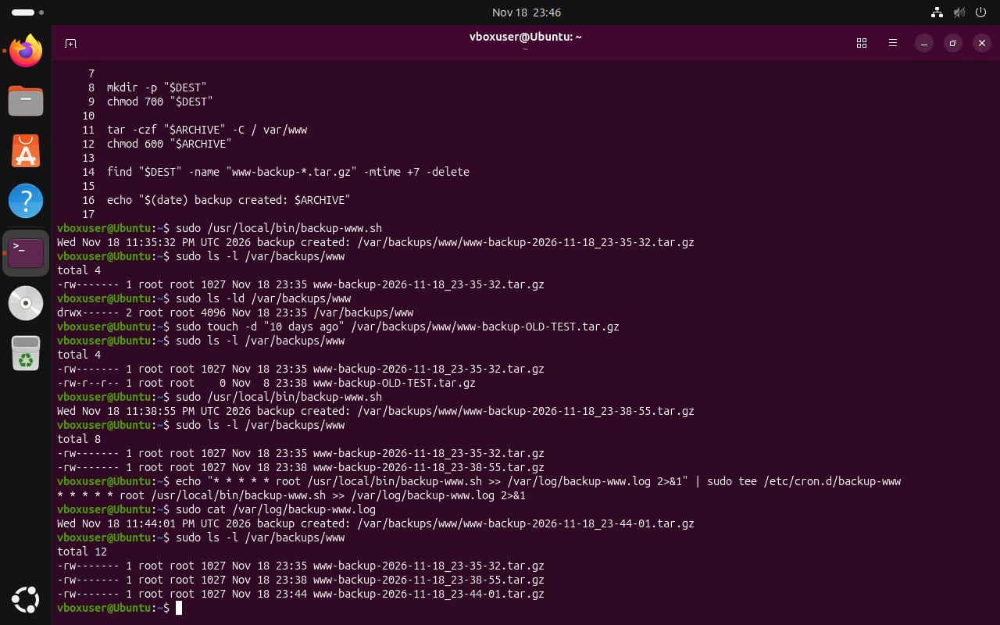
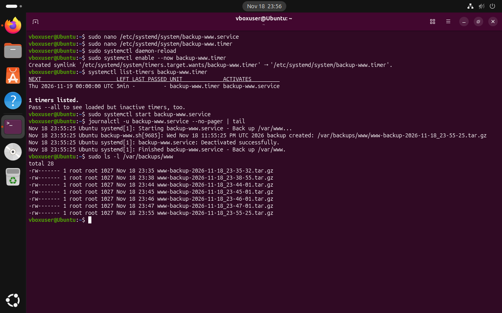

# Automated Website Backups with Bash, cron, and systemd

**Phase:** 2 (Cloud Bootcamp) | **Tools:** Bash, tar, find, cron, systemd timers, journalctl | **OS:** Ubuntu

## Business Scenario
If a website's files are deleted or corrupted, the business needs a recent copy it can restore. This project automates daily, secured backups of `/var/www` with a 7-day retention policy, so backups never fill the disk and old copies clean themselves up.

## Architecture



## The Script

`/usr/local/bin/backup-www.sh`
```bash
#!/bin/bash
# Back up /var/www into a timestamped archive and keep 7 days of backups

SOURCE="/var/www"
DEST="/var/backups/www"
STAMP=$(date +%Y-%m-%d_%H-%M-%S)
ARCHIVE="$DEST/www-backup-$STAMP.tar.gz"

# Create the backup folder and lock it down to root only
mkdir -p "$DEST"
chmod 700 "$DEST"

# Create the archive and lock down the file
tar -czf "$ARCHIVE" -C / var/www
chmod 600 "$ARCHIVE"

# Delete backups older than 7 days
find "$DEST" -name "www-backup-*.tar.gz" -mtime +7 -delete

echo "$(date) backup created: $ARCHIVE"
```

| Part | Purpose |
|---|---|
| Timestamp in the file name | Every backup is unique and easy to sort |
| `chmod 700` folder, `chmod 600` file | Only root can read backups, since they contain the full site |
| `tar -czf ... -C / var/www` | Compressed archive with clean relative paths |
| `find ... -mtime +7 -delete` | Retention policy: automatically removes backups older than 7 days |

## Scheduling

**Option 1: cron** (daily at 2:00 AM, output logged)
```bash
# /etc/cron.d/backup-www
0 2 * * * root /usr/local/bin/backup-www.sh >> /var/log/backup-www.log 2>&1
```

**Option 2: systemd timer** (stretch goal)
```ini
# /etc/systemd/system/backup-www.service
[Unit]
Description=Back up /var/www

[Service]
Type=oneshot
ExecStart=/usr/local/bin/backup-www.sh
```
```ini
# /etc/systemd/system/backup-www.timer
[Unit]
Description=Run the /var/www backup daily

[Timer]
OnCalendar=daily
Persistent=true

[Install]
WantedBy=timers.target
```
```bash
sudo systemctl daemon-reload
sudo systemctl enable --now backup-www.timer
```

## Verification

| Test | How | Result |
|---|---|---|
| Backup is created | Ran the script, listed `/var/backups/www` | Timestamped `.tar.gz` with `-rw-------` |
| Folder is locked down | `ls -ld /var/backups/www` | `drwx------` |
| Archive contains the site | `tar -tzf <archive> \| head` | Files from `var/www/` |
| Retention works | Created a fake backup dated 10 days ago with `touch -d "10 days ago"`, then ran the script | Old file deleted |
| cron runs it | Temporarily scheduled every minute, checked the log | New backups and log entries |
| Timer runs it | `systemctl start backup-www.service`, `journalctl -u backup-www.service` | Backup created, logged in the journal |

## Screenshots






## cron vs systemd Timer

| | cron | systemd timer |
|---|---|---|
| Setup | One line | Two files (`.service` + `.timer`) |
| Schedule | `0 2 * * *` | `OnCalendar=daily` |
| Machine was off at run time | Run is skipped | Runs at next boot (`Persistent=true`) |
| Logs | Only what you redirect | Built in with `journalctl` |
| See next run | Not built in | `systemctl list-timers` |

In production I'd pick one scheduler, not both, so the backup doesn't run twice.

## What I Learned
- Writing safe, readable Bash scripts with variables and quoting
- File permissions for sensitive data
- How to **test** a retention policy instead of waiting a week
- Tradeoffs between cron and systemd timers

## Business Value
Backups and retention are core to business continuity planning. A backup only counts if it runs automatically, is protected, and is tested. The same principles apply to AWS Backup, EBS snapshots, and S3 lifecycle rules.

## Next Iteration
- Copy each backup to an **S3 bucket** so it survives if the server is lost
- Use an **S3 lifecycle rule** to move older backups to Glacier
- Add a restore script and test a full restore
- Send an alert if a backup fails
