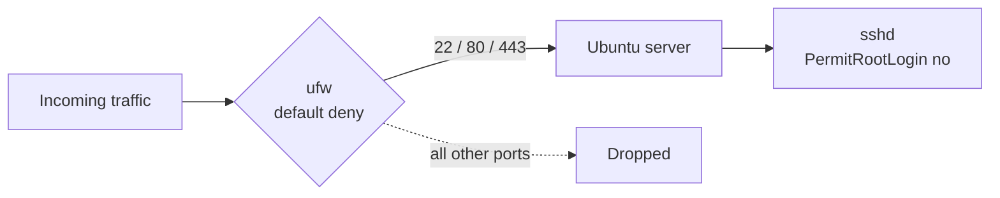
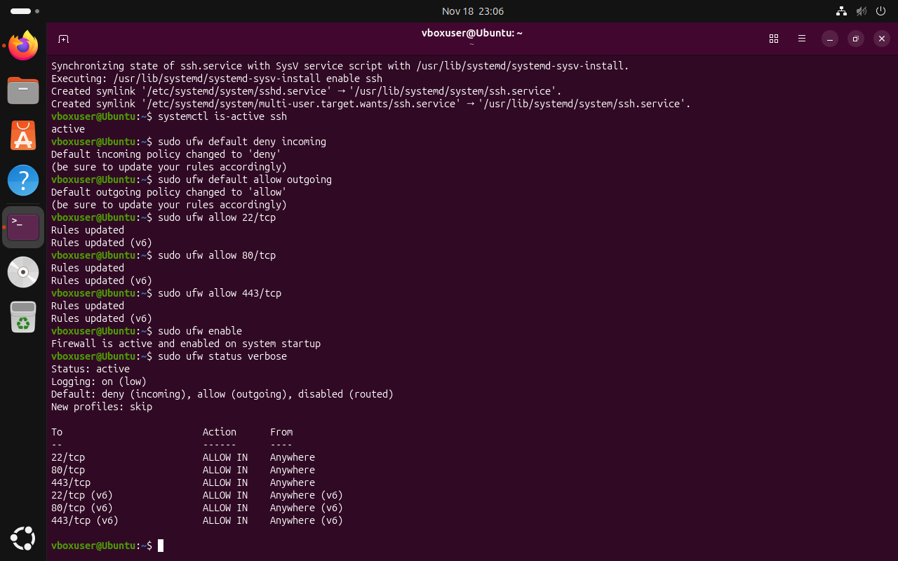
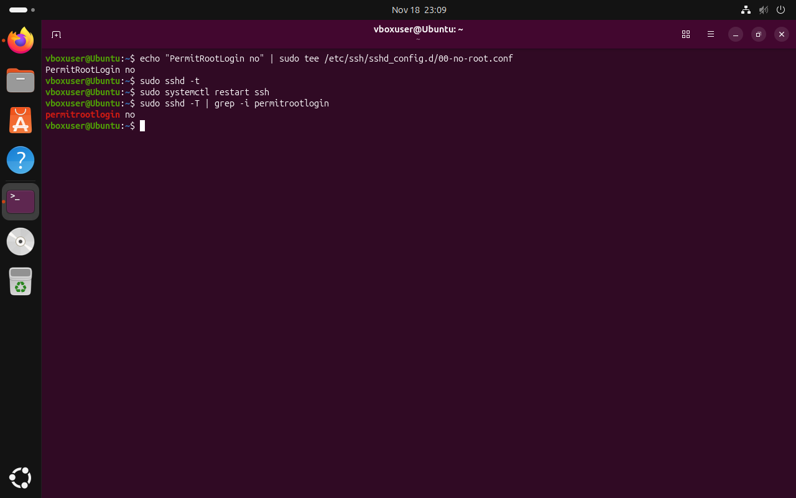

# Firewall and SSH Hardening on Ubuntu

**Phase:** 2 (Cloud Bootcamp) | **Tools:** Ubuntu, ufw, OpenSSH

## Business Scenario
A public-facing web server should expose only what it needs: SSH for administration, and HTTP/HTTPS for visitors. Everything else should be blocked, and nobody should be able to log in directly as root.

## Security Goals

| Port | Service | Status |
|---|---|---|
| 22 | SSH | ✅ Allowed |
| 80 | HTTP | ✅ Allowed |
| 443 | HTTPS | ✅ Allowed |
| Everything else | | ❌ Blocked |
| Root login over SSH | | ❌ Disabled |

## Architecture



## What I Built

**1. Installed and enabled SSH**
```bash
sudo apt install -y openssh-server
sudo systemctl enable --now ssh
```

**2. Firewall: default deny, then allow only what's needed**
```bash
sudo ufw default deny incoming
sudo ufw default allow outgoing
sudo ufw allow 22/tcp
sudo ufw allow 80/tcp
sudo ufw allow 443/tcp
sudo ufw enable
sudo ufw status verbose
```

**3. Disabled root login over SSH**
```bash
echo "PermitRootLogin no" | sudo tee /etc/ssh/sshd_config.d/00-no-root.conf
sudo sshd -t                                   # validate config before restarting
sudo systemctl restart ssh
sudo sshd -T | grep -i permitrootlogin         # confirms: permitrootlogin no
```
The `00-` prefix makes this file load first, so it takes priority over other SSH settings.

## Verification

| Check | Command | Result |
|---|---|---|
| Firewall is on | `sudo ufw status verbose` | `Status: active` |
| Default policy | same | `deny (incoming), allow (outgoing)` |
| Allowed ports | same | Only 22, 80, and 443 (IPv4 and IPv6) |
| Root login | `sudo sshd -T \| grep -i permitrootlogin` | `permitrootlogin no` |

## Screenshots

### ufw rules: default deny, only 22, 80, and 443 allowed


### Root SSH login disabled


## What I Learned
- **Default deny** is the safest starting point: open only what you need
- ufw adds matching IPv6 rules automatically
- Drop-in config files in `sshd_config.d/` are cleaner than editing the main config
- Validate config (`sshd -t`) before restarting a service so you don't lock yourself out

## Business Value
Most breaches start with an exposed service or weak remote access. This is the same thinking behind AWS **security groups** and **network ACLs**, and it's the kind of evidence security audits and compliance reviews ask for.

## Next Iteration
- Verify the rules from a second machine with `nmap`, since a server scanning itself bypasses its own firewall
- Repeat the build on AlmaLinux with firewalld
- Switch SSH to key-only authentication and add fail2ban
- Recreate the rules as AWS security groups on EC2
