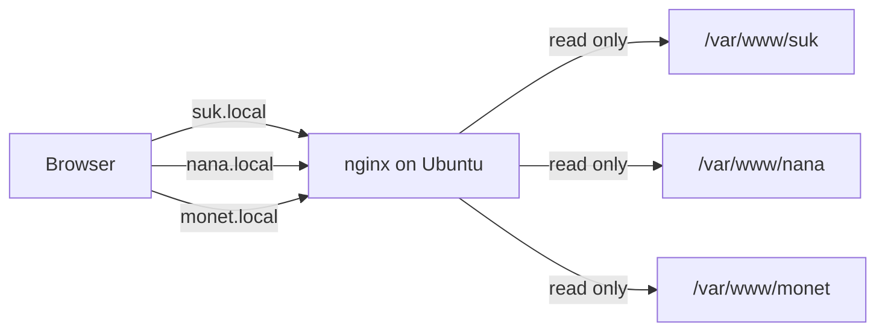
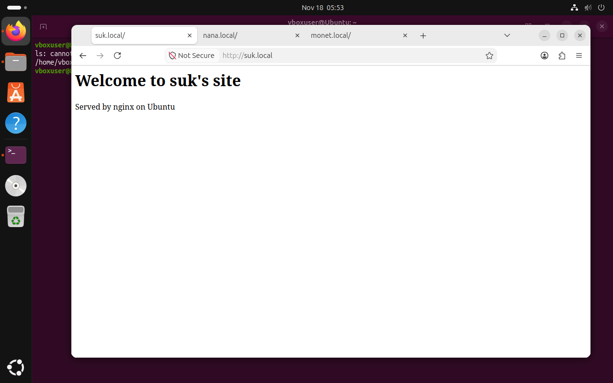
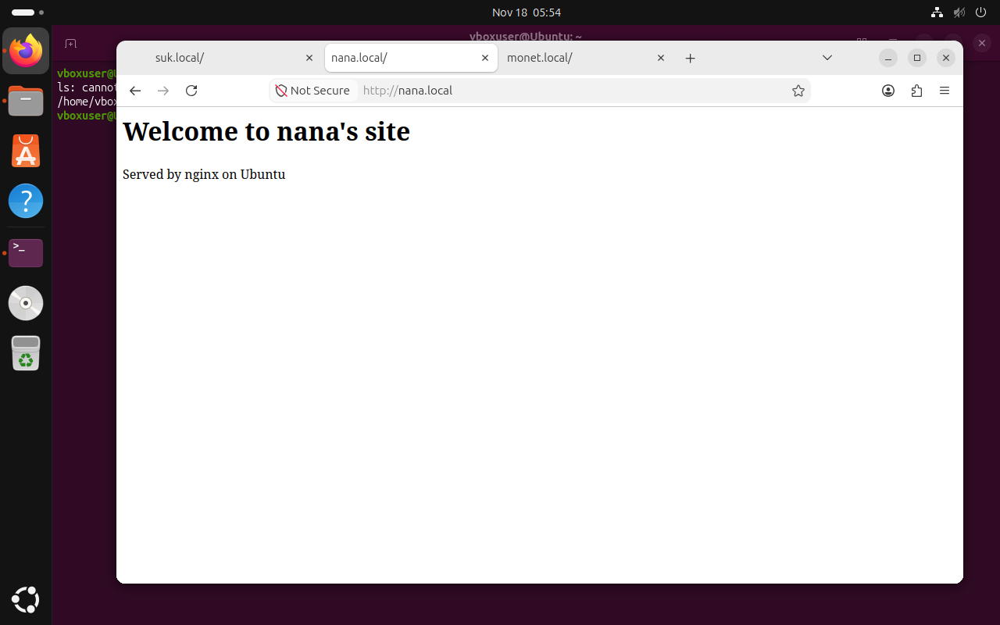
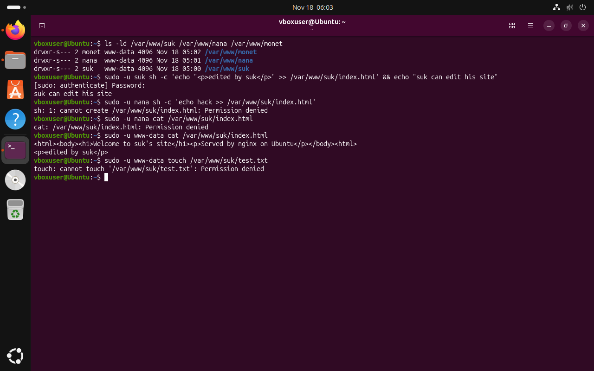

# Multi-User Web Server on Ubuntu with nginx

**Phase:** 2 (Cloud Bootcamp) | **Tools:** Ubuntu, nginx, Linux users, groups, and permissions

## Business Scenario
A shared web server hosts sites for three users: suk, nana, and monet. Each person must be able to edit their own site and nobody else's, and the web server must be able to read every site without being able to change any of them.

## Architecture



## Permission Design

| Path | Owner : Group | Mode | Effect |
|---|---|---|---|
| `/var/www/<user>` | `<user>` : `www-data` | `2750` | Owner has full control. nginx can read and enter. Other users get nothing. The setgid bit (`2`) makes new files inherit the `www-data` group |
| `/var/www/<user>/index.html` | `<user>` : `www-data` | `640` | Owner can edit. nginx can read. Nobody else |

## What I Built
1. Installed and enabled nginx
2. Created three users with `useradd -m`
3. Created a site directory per user and applied the ownership and permissions above
4. Created each `index.html` **as that user** with `sudo -u`, so ownership is correct from the start
5. Configured one nginx server block per user and enabled it with a symlink into `sites-enabled`
6. Mapped `suk.local`, `nana.local`, and `monet.local` in `/etc/hosts`

## Key Configuration

**nginx server block**
```nginx
server {
    listen 80;
    server_name suk.local;
    root /var/www/suk;
    index index.html;
}
```

**Permissions**
```bash
sudo chown suk:www-data /var/www/suk
sudo chmod 2750 /var/www/suk
sudo chmod 640 /var/www/suk/index.html
```

**Enable, test, reload**
```bash
sudo ln -s /etc/nginx/sites-available/suk /etc/nginx/sites-enabled/suk
sudo nginx -t
sudo systemctl reload nginx
```

## Verification

```bash
curl http://suk.local                                                # site loads
sudo -u suk  sh -c 'echo "<p>edited by suk</p>" >> /var/www/suk/index.html'   # succeeds
sudo -u nana sh -c 'echo hack >> /var/www/suk/index.html'           # Permission denied
sudo -u nana cat /var/www/suk/index.html                            # Permission denied
sudo -u www-data cat /var/www/suk/index.html                        # succeeds (read)
sudo -u www-data touch /var/www/suk/test.txt                        # Permission denied (no write)
```

| Test | Result |
|---|---|
| Owner edits own site | ✅ Allowed |
| Another user reads or edits it | ❌ Denied |
| Web server reads it | ✅ Allowed |
| Web server writes to it | ❌ Denied |

## Screenshots

### Each user's site served by nginx
| suk.local | nana.local | monet.local |
|---|---|---|
|  |  |  |

### Permission tests
Owner can edit, another user is denied, and the web server can read but not write.



## Troubleshooting Notes

| Problem | Likely cause | Fix |
|---|---|---|
| 403 Forbidden | Wrong group or mode on the site folder | Set group to `www-data` and mode `2750`, check with `ls -ld` |
| Default nginx page instead of the user's site | Hostname missing from `/etc/hosts`, or browsing by IP | Add the `.local` names and browse by name |
| nginx won't reload | Syntax error in a server block | Run `sudo nginx -t` to find the line |

## What I Learned
- Linux permission bits, groups, and the **setgid** bit for shared directories
- How nginx organizes sites with `sites-available` and `sites-enabled`
- Always test access as each user, not as root

## Business Value
This is least privilege applied at the operating system level, the same idea as IAM in AWS. Shared hosting, multi-team servers, and EC2 instances running Linux all depend on getting these permissions right.

## Next Iteration
- Repeat the build on AlmaLinux with Apache and SELinux
- Add HTTPS with Let's Encrypt
- Rebuild on EC2 and automate the setup with a script
