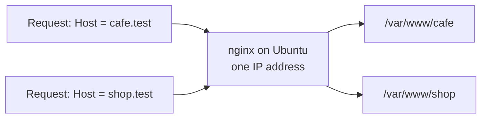
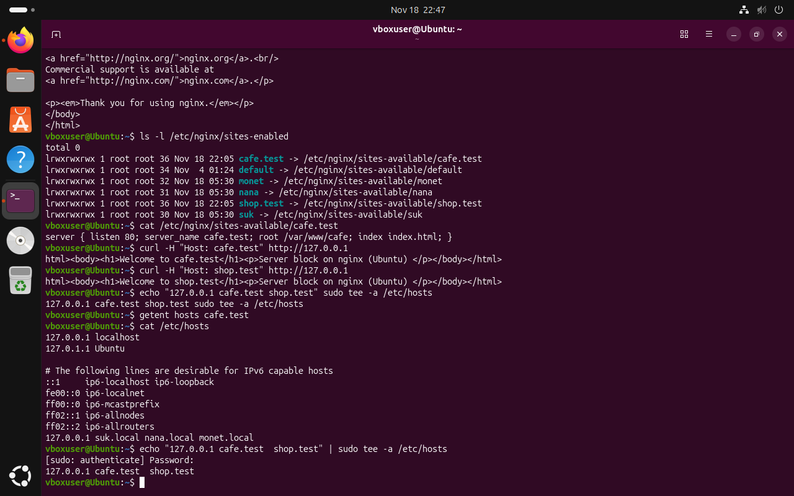

# Name-Based Virtual Hosting: One Server, Many Websites

**Phase:** 2 (Cloud Bootcamp) | **Tools:** Ubuntu, nginx server blocks, `curl`, `/etc/hosts`

## Business Scenario
Running a separate server for every website wastes money. With name-based virtual hosting, one server and one IP address can serve many sites, choosing the right one based on the domain name the visitor requested. This build serves `cafe.test` and `shop.test` from one Ubuntu server running nginx.

The `.test` domain is reserved for testing, so these names never clash with real websites.

## Architecture



**How it works:** every browser request includes a `Host` header with the domain name. nginx matches it against each server block's `server_name` and serves that site's folder.

## What I Built
1. Created a folder and `index.html` for each domain under `/var/www`
2. Wrote a server block for each domain in `/etc/nginx/sites-available/`
3. Enabled both sites with symlinks into `sites-enabled`
4. Tested the config with `nginx -t` and reloaded nginx
5. Mapped both domains in `/etc/hosts` so the VM could resolve them without real DNS

## Key Configuration

```nginx
# /etc/nginx/sites-available/cafe.test
server { listen 80; server_name cafe.test; root /var/www/cafe; index index.html; }

# /etc/nginx/sites-available/shop.test
server { listen 80; server_name shop.test; root /var/www/shop; index index.html; }
```

```bash
sudo ln -s /etc/nginx/sites-available/cafe.test /etc/nginx/sites-enabled/cafe.test
sudo ln -s /etc/nginx/sites-available/shop.test /etc/nginx/sites-enabled/shop.test
sudo nginx -t
sudo systemctl reload nginx
```

## Verification

```bash
# Send the Host header directly, the way a browser does
curl -H "Host: cafe.test" http://127.0.0.1
curl -H "Host: shop.test" http://127.0.0.1

# Then map the names and open them in Firefox
echo "127.0.0.1 cafe.test shop.test" | sudo tee -a /etc/hosts
```

Each request returned the matching site's page from the same server.

## Screenshots

| cafe.test | shop.test |
|---|---|
|  |  |

### Enabled server blocks, curl tests, and /etc/hosts


## Troubleshooting Note
My first attempt to add the hosts entry was missing the `|` pipe, so the text printed to the screen instead of being written to `/etc/hosts` (visible in the screenshot). Running `cat /etc/hosts` caught it, and I re-ran the command correctly. Always verify a config change instead of assuming it worked.

## What I Learned
- How the HTTP `Host` header makes name-based hosting possible
- How to test a web server with `curl -H` before DNS exists
- How `/etc/hosts` overrides DNS on a single machine
- nginx's available/enabled pattern makes it easy to switch a site off without deleting its config

## Business Value
This is how agencies, consultants, and hosting providers serve many client sites cheaply. The same idea applies in AWS with Application Load Balancer host-based routing, where one load balancer sends traffic to different apps based on the domain.

## Next Iteration
- Repeat the build on AlmaLinux with Apache virtual hosts
- Add HTTPS certificates per domain
- Replace `/etc/hosts` with real DNS records in Route 53
