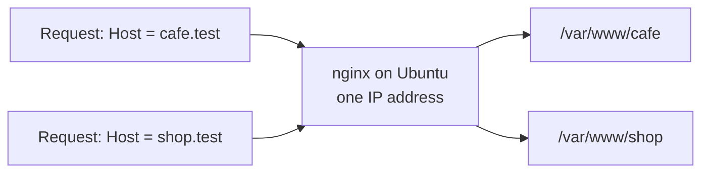
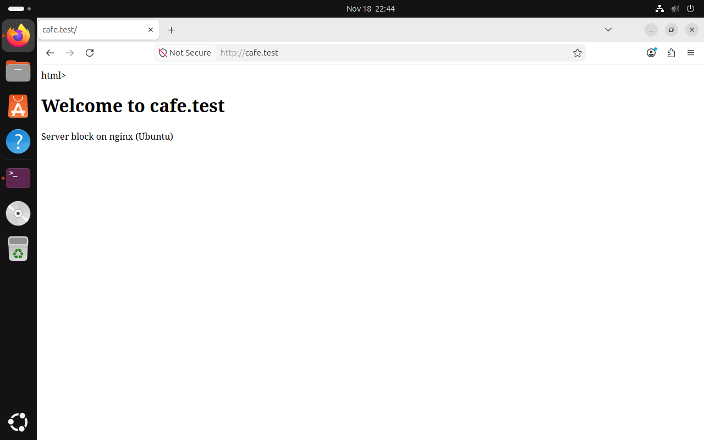

# Name-Based Virtual Hosting: One Server, Many Websites

**Phase:** 2 (Cloud Bootcamp) | **Tools:** nginx server blocks, Apache virtual hosts, Ubuntu, AlmaLinux, `/etc/hosts`

## Business Scenario
Running a separate server for every website wastes money. With name-based virtual hosting, one server and one IP address can serve many sites, choosing the right one based on the domain name the visitor requested.

- **Ubuntu + nginx:** `cafe.test` and `shop.test`
- **AlmaLinux + Apache:** `books.test` and `music.test`

The `.test` domain is reserved for testing, so these names never clash with real websites.

## Architecture



**How it works:** every browser request includes a `Host` header with the domain name. The server matches it against `server_name` (nginx) or `ServerName` (Apache) and serves that site's folder.

## What I Built
1. Created a folder and `index.html` for each domain under `/var/www`
2. Wrote a server block (nginx) or virtual host (Apache) for each domain
3. Enabled the nginx sites with symlinks into `sites-enabled`. On Apache, any `.conf` file in `conf.d` loads automatically
4. Tested the config, then reloaded or restarted the service
5. Mapped the domains in `/etc/hosts` so each VM could resolve them without real DNS

## Key Configuration

```nginx
# /etc/nginx/sites-available/cafe.test
server { listen 80; server_name cafe.test; root /var/www/cafe; index index.html; }
```

```apache
# /etc/httpd/conf.d/books.test.conf
<VirtualHost *:80>
    ServerName books.test
    DocumentRoot /var/www/books
</VirtualHost>
```

## Verification

```bash
# Send the Host header directly, the way a browser does
curl -H "Host: cafe.test" http://127.0.0.1
curl -H "Host: shop.test" http://127.0.0.1

# After adding /etc/hosts entries, browse by name
curl http://books.test
curl http://music.test
```

Each request returned the matching site's page from the same server.

## Screenshots

| | |
|---|---|
|  |  |
|  |  |


## nginx vs Apache Comparison

| | nginx (Ubuntu) | Apache (AlmaLinux) |
|---|---|---|
| Name | Server block | Virtual host |
| Syntax | `server { ... }`, settings end in `;` | `<VirtualHost *:80> ... </VirtualHost>` |
| Domain | `server_name cafe.test;` | `ServerName books.test` |
| Site folder | `root /var/www/cafe;` | `DocumentRoot /var/www/books` |
| Config location | `/etc/nginx/sites-available/` | `/etc/httpd/conf.d/` |
| Turn a site on | Symlink into `sites-enabled/` | Drop a `.conf` file in `conf.d/` |
| Turn a site off | Remove the symlink, keep the config | Rename or delete the `.conf` file |
| Check config | `nginx -t` | `apachectl configtest` |
| Apply changes | `systemctl reload nginx` | `systemctl restart httpd` |
| Extra security layer | None by default | SELinux (`restorecon`) |

## What I Learned
- How the HTTP `Host` header makes name-based hosting possible
- How to test web servers with `curl -H` before DNS exists
- How `/etc/hosts` overrides DNS on a single machine
- nginx's available/enabled pattern makes it easy to switch a site off without deleting its config

## Business Value
This is how agencies, consultants, and hosting providers serve many client sites cheaply. The same idea applies in AWS with Application Load Balancer host-based routing, where one load balancer sends traffic to different apps based on the domain.

## Next Iteration
- Add HTTPS certificates per domain
- Replace `/etc/hosts` with real DNS records in Route 53
