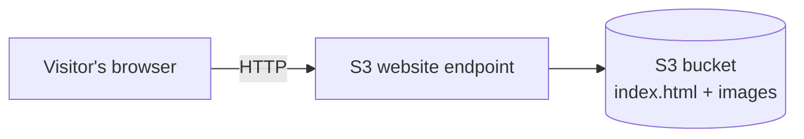
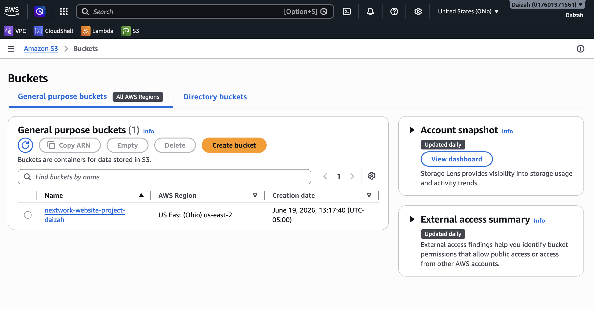
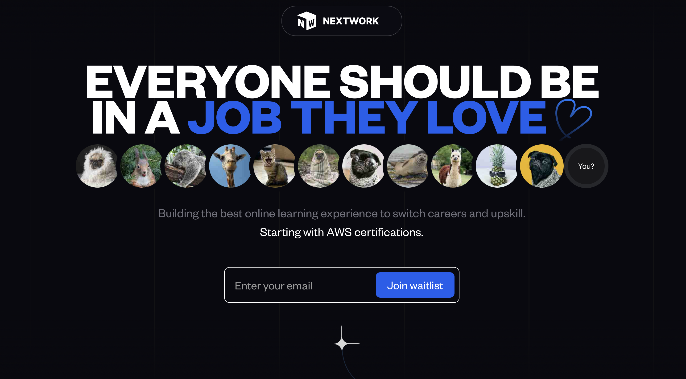

# Host a Website on Amazon S3

**Phase:** 1 (AWS Foundations) | **Services:** Amazon S3 | **Source:** Nextwork AWS Cloud Beginner series

## Business Scenario
A small business needs a fast, low-cost website without paying for or maintaining a server. Amazon S3 can serve static sites directly, with no servers to patch and costs measured in cents for low traffic.

## Architecture

## What I Built
- Created an S3 bucket and uploaded the site's HTML and image files
- Enabled **static website hosting** on the bucket and set `index.html` as the index document
- Turned off **Block Public Access** for this bucket only and made the objects publicly readable
- Opened the bucket's website endpoint URL to confirm the site loaded

## Verification
The site loaded in a browser from the S3 website endpoint, with no EC2 instance or web server involved.

## Screenshots

### S3 bucket in the AWS console

### Live website served from S3

## What I Learned
- S3 stores **objects** inside **buckets**, and a bucket can act as a web host
- AWS blocks public access by default. Opening it is a deliberate choice and should be limited to content meant to be public
- The difference between the bucket's normal object URL and its **website endpoint**

## Business Value
For brochure sites, landing pages, and documentation, S3 hosting removes server maintenance and cuts hosting cost to almost nothing. It's a common first step when moving a small client's web presence to AWS.

## Next Iteration
- Put **CloudFront** in front of the bucket for HTTPS and faster global delivery
- Keep the bucket private and allow access only through CloudFront (Origin Access Control)
- Point a custom domain at it with **Route 53**

## Resources
- [Nextwork project guide](https://learn.nextwork.org/projects/aws-host-a-website-on-s3)
- [Amazon S3 documentation](https://docs.aws.amazon.com/s3/)
