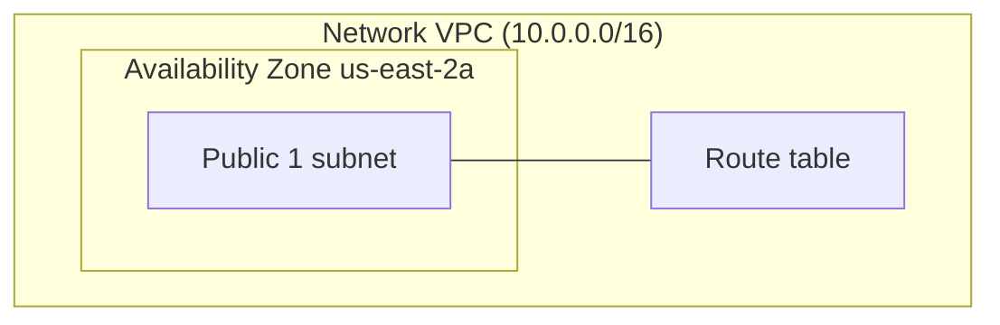
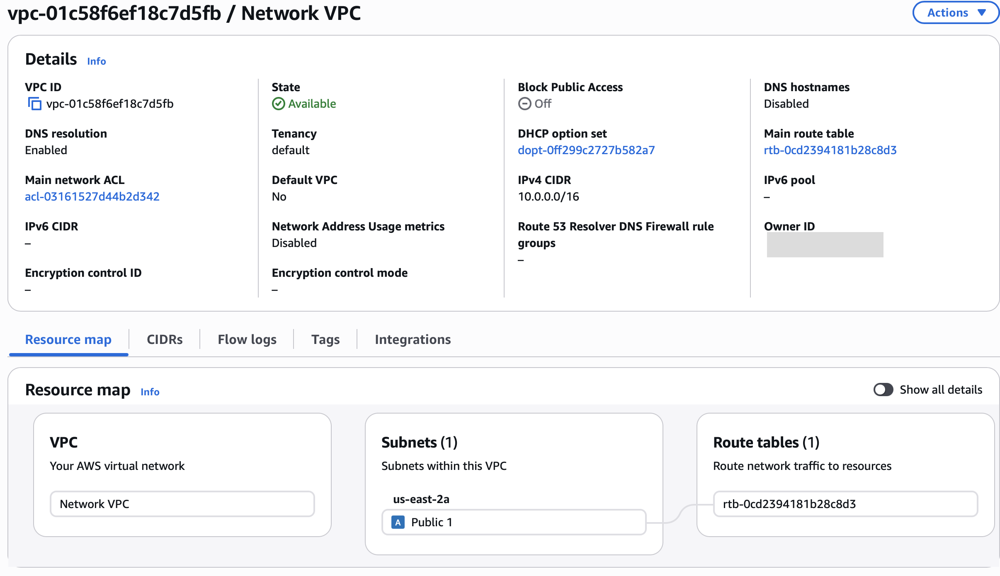

# Build a Custom Virtual Private Cloud (VPC)

**Phase:** 1 (AWS Foundations) | **Services:** Amazon VPC, Subnets, Route Tables | **Region:** us-east-2 (Ohio) | **Source:** Nextwork AWS Cloud Beginner series

## Business Scenario
Every AWS workload runs inside a network. Instead of relying on the default VPC, companies build their own so they control the IP ranges, separate public and private resources, and decide exactly how traffic flows. This project builds that foundation.

## Architecture

## What I Built
- Created a custom VPC named **Network VPC** with the IPv4 CIDR block **10.0.0.0/16** (65,536 addresses)
- Created a subnet named **Public 1** in the **us-east-2a** Availability Zone
- Associated the subnet with a route table to control where its traffic goes
- Used the VPC **resource map** to confirm how the VPC, subnet, and route table connect

## Verification
The VPC shows as **Available**, and the resource map shows the VPC, its subnet, and the route table linked together.

## Screenshots

## What I Learned
- A VPC is a private, isolated network inside AWS
- **CIDR notation**: `/16` gives a large address range that can be split into smaller subnets (for example `/24` subnets of 256 addresses each)
- Subnets live in a single Availability Zone, so high availability means spreading subnets across zones
- **Route tables** decide where traffic goes. A subnet is only "public" when its route table points to an **internet gateway**
- Why a custom VPC beats the default one: you control the design instead of inheriting it

## Business Value
Network design is the first decision in any cloud migration and the hardest to change later. Understanding CIDR planning and subnets lets me ask the right questions early, like how many environments we need, what must stay private, and how we connect back to the office network.

## Next Iteration
- Attach an **internet gateway** and add a `0.0.0.0/0` route for true public access
- Add a **private subnet** and a **NAT gateway** for back-end servers
- Spread subnets across two Availability Zones for high availability
- Add **security groups** and **network ACLs**, and enable **VPC Flow Logs**

## Resources
- [Nextwork project guide](https://learn.nextwork.org/projects/aws-networks-vpc?track=high)
- [Amazon VPC documentation](https://docs.aws.amazon.com/vpc/)
